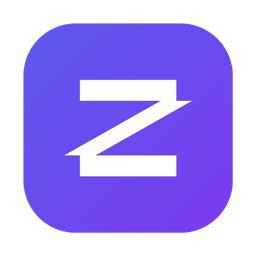

<div align="center">



# EmuZip

**Gerenciador de emulador Android rápido, leve e bonito — escrito em Rust.**

Crie, execute e depure dispositivos Android com a tela embutida no próprio app.
Sem Android Studio. Sem Java. Sem `sdkmanager`.

[](https://github.com/LuisPeixoto/EmuZip/actions/workflows/ci.yml)
[](https://github.com/LuisPeixoto/EmuZip/releases)
[](LICENSE)
[](https://www.rust-lang.org)
[](https://slint.dev)
[](CONTRIBUTING.md)

[English](README.md) · [Português (Brasil)](README.pt-BR.md)

<br />


</div>

---

## Por que o EmuZip?

As ferramentas oficiais do Android são poderosas, mas pesadas. O EmuZip controla o **Android Emulator oficial do Google** (ou o QEMU puro) por meio de um app nativo pequeno, que abre na hora e reúne tudo o que você usa no desenvolvimento — em uma única janela.

- ⚡ **Nativo e leve** — um único binário Rust com interface [Slint](https://slint.dev). Sem JVM, sem Electron.
- 🖥️ **Tela embutida** — a tela do Android chega por gRPC direto no app, com toque, teclado, rolagem e rotação.
- 📦 **Imagens oficiais, sem configuração** — navegue pelo catálogo do Google e baixe com progresso e verificação SHA-1.
- 🧰 **Tudo em um painel lateral** — bateria, GPS, rede, sensores, câmera, biometria, logcat, shell, desempenho e mais.
- 🌍 **Fala o seu idioma** — inglês por padrão, além de Português (BR), Español, Français, Deutsch e 中文, com troca ao vivo.
- 🔎 **Inspetor de rede embutido** — proxy MITM em Rust que exporta HAR, Postman, cURL, JSON e CSV.

## Capturas de tela

<table>
  <tr>
    <td width="50%"><br /><sub><b>Dispositivos</b> — crie, inicie, clone e gerencie.</sub></td>
    <td width="50%"><br /><sub><b>Imagens</b> — imagens oficiais, verificadas e instaladas nativamente.</sub></td>
  </tr>
  <tr>
    <td width="50%"><br /><sub><b>Player</b> — visão imersiva com barra de ferramentas enxuta.</sub></td>
    <td width="50%"><br /><sub><b>Configurações</b> — tema, idioma, caminhos e emulação.</sub></td>
  </tr>
</table>

A galeria completa dos painéis de ferramentas está no [README em inglês](README.md#screenshots) e em [docs/features.md](docs/features.md).

## Recursos

| | |
|---|---|
| **Dispositivos** | Assistente de 4 passos com 13 perfis de hardware · iniciar, cold boot, parar, reiniciar · clonar, renomear, restaurar de fábrica, excluir · reparar AVDs quebrados · busca, filtros, grade ou lista. |
| **Imagens** | Catálogo oficial do Google (8 canais) · download nativo com progresso, velocidade e ETA · verificação SHA-1 · cancelamento. |
| **Player** | Streaming de tela por gRPC · toque, arrasto, teclado e rolagem · voltar / home / recentes · power, volume, girar · tela cheia e *ajustar janela*. |
| **Ferramentas** | Bateria · GPS (cidades e trajeto simulado) · rede · telefone e SMS · sensores · biometria · câmeras · tela · identificadores · apps · arquivos · clipboard · snapshots · logcat · shell · proxy e idioma. |
| **Capturas** | Screenshots (PNG) e gravação de tela (MP4). |
| **Inspetor de rede** | Proxy MITM em Rust com CA próprio · visualização de request/response · exporta **HAR 1.2, JSON, CSV, Postman v2.1, cURL**. |
| **Desempenho** | CPU / RAM / GPU do host e do Android · gráficos de 60 s · quem consome mais · estresse de memória. |
| **Idiomas** | English, Português (BR), Español, Français, Deutsch, 中文 (简体). |
| **CLI** | `emuzipctl` para scripts e CI. Veja [docs/cli.md](docs/cli.md). |

## Instalação

### Download

Baixe o instalador da sua plataforma na página de [**Releases**](https://github.com/LuisPeixoto/EmuZip/releases):

| Plataforma | Pacote |
|---|---|
| macOS (Apple Silicon / Intel) | `.dmg` |
| Windows | instalador `.exe` (NSIS) |
| Linux | `.deb` ou `.AppImage` |

### Requisitos

- **Android SDK** com os pacotes `emulator` e `platform-tools`. O EmuZip encontra sozinho (`ANDROID_HOME`, `ANDROID_SDK_ROOT` ou os locais padrão de cada sistema) — ou informe em **Configurações → Caminhos**.
- Aceleração por hardware: Hypervisor.framework (macOS), Windows Hypervisor Platform (Windows) ou KVM (Linux).
- O **QEMU** é opcional.

Não precisa de Java nem de `sdkmanager`.

### Compilar do código-fonte

```sh
git clone https://github.com/LuisPeixoto/EmuZip.git
cd EmuZip
cargo build --release
```

Os binários **`EmuZip`** (app) e **`emuzipctl`** (CLI) ficam em `target/release/`. No Linux são necessárias algumas bibliotecas do sistema — veja [docs/development.md](docs/development.md).

## Primeiros passos

1. Abra o EmuZip e vá em **Imagens**. Escolha uma imagem no **Catálogo** e baixe.
2. Vá em **Dispositivos → Novo dispositivo**, escolha um perfil de hardware e a imagem instalada.
3. Clique em **Iniciar**. A tela do Android aparece dentro do app.
4. Use a barra de ferramentas à direita para mudar bateria, localização, rede, sensores e mais.

## Idiomas

A interface é em **inglês por padrão** e segue o idioma do sistema quando você escolhe **System** em *Settings → Language*. Para adicionar seu idioma basta um arquivo `.po` — veja [docs/translations.md](docs/translations.md).

```sh
EMUZIP_LANG=pt-BR ./target/release/EmuZip   # testa um idioma sem alterar as configurações
```

## Estrutura do projeto

Veja a tabela de crates no [README em inglês](README.md#project-layout) e o guia em [docs/architecture.md](docs/architecture.md).

## Contribuindo

Contribuições de qualquer tamanho são bem-vindas — bugs, traduções, documentação e código. Leia o [CONTRIBUTING.md](CONTRIBUTING.md) e o [Código de Conduta](CODE_OF_CONDUCT.md). Encontrou uma falha de segurança? Veja o [SECURITY.md](SECURITY.md).

## Licença

O EmuZip é distribuído sob a [Licença MIT](LICENSE).

Android e o robô Android são marcas registradas da Google LLC. O EmuZip é um projeto independente, sem afiliação ou endosso do Google.
