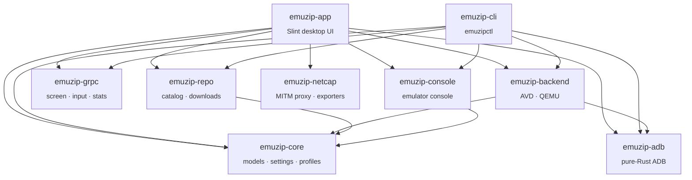

# Architecture

EmuZip is a Cargo workspace of small, focused crates. The desktop app (`emuzip-app`) is a thin UI layer; all the real work happens in reusable library crates that the CLI (`emuzipctl`) shares.



## Crates

| Crate | Responsibility |
|---|---|
| `emuzip-core` | Shared models (`Device`, `State`, hardware profiles), persistent settings (`settings.toml`), installed-image discovery, SDK detection. |
| `emuzip-adb` | A pure-Rust implementation of the ADB client protocol: `shell`, `exec`, sync `push`/`pull`, `install`, `logcat`. Talks to the local `adb` server — no `adb` binary invocation for these operations. |
| `emuzip-console` | Client for the emulator's telnet-style console: network speed/latency, signal, snapshots, rotation. |
| `emuzip-grpc` | gRPC client for the emulator controller (screen streaming, touch/keyboard input, stats). Protos live in `proto/` and are compiled with `protox` at build time, so **`protoc` is not required**. |
| `emuzip-repo` | Reads Google's official SDK repository catalog, downloads images natively with progress and cancellation, verifies SHA-1 and extracts. |
| `emuzip-netcap` | A MITM HTTP(S) proxy built on `hudsucker`, with its own locally generated CA, an in-memory store and exporters for HAR 1.2, JSON, CSV, Postman v2.1 and cURL. |
| `emuzip-backend` | The `Backend` trait with two implementations: `AvdBackend` (Google's emulator, Java-free AVD creation/repair) and a QEMU backend. |
| `emuzip-cli` | The `emuzipctl` binary. |
| `emuzip-app` | The `EmuZip` desktop application. |

## The desktop app

`crates/emuzip-app` mixes declarative UI and Rust glue:

```
crates/emuzip-app/
├── ui/                 Slint components (one file per screen/area)
│   ├── app.slint         main window and navigation
│   ├── devices.slint     device list, cards, filters
│   ├── wizard.slint      "New device" wizard
│   ├── images.slint      image catalog and installed images
│   ├── player.slint      embedded display and tool panels
│   ├── network.slint     network inspector
│   ├── perf.slint        performance monitor
│   ├── settings.slint    settings
│   ├── store.slint       global state, API callbacks
│   └── icons/            SVG icon set
├── src/                Rust glue — one module per UI area
│   ├── main.rs           entry point, wiring
│   ├── ctx.rs            shared context, task/activity helpers
│   ├── i18n.rs           translation runtime
│   └── …
├── translations/       gettext catalogs, one folder per language
└── i18n/               translation template (.pot)
```

State flows through Slint **globals** (`Store`, `Prefs`, `Player`, `Net`, `Perf`, …) and an `Api` global of callbacks implemented in Rust. Long-running work is spawned on a Tokio runtime and reports progress to the **Activity center**.

## Internationalization

- UI text is written in **English** (the source language).
- Slint uses `@tr("…")`, Rust uses `tr!("…")`; both read the same bundled `.po` catalogs.
- Language is applied live: `i18n::set_language` swaps the Rust catalog and calls Slint's `select_bundled_translation`.

See [translations.md](translations.md) for how to add a language.

## Data on disk

| What | Where |
|---|---|
| Settings | `settings.toml` in the platform data directory (`directories::ProjectDirs("br", "vidyacode", "EmuZip")`) |
| Network inspector CA | `ca.pem` / `ca.key`, generated once per machine |
| AVDs | `$ANDROID_AVD_HOME`, or `~/.android/avd`, or the path set in Settings |
| Captures | `~/Pictures/EmuZip` (configurable) |
